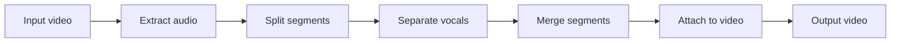

# CleanVedio

**CleanVedio** is a local video processing pipeline that attenuates background music and emphasizes **vocals and speech**, producing a new video with cleaner dialogue-centric audio.

Processing runs on your machine: a small **Flask** web UI queues jobs, or you can invoke the pipeline from **Python** or batch scripts. YouTube URLs are fetched with **yt-dlp**; separation uses **Spleeter** (CLI) or a bundled **EM** runtime when packaged.

---

## Features

- **Web UI** — Submit YouTube links or local files; track jobs and download results.
- **Async jobs** — REST endpoints for enqueue and status (`POST /process`, `GET /jobs/<id>`).
- **Local batch** — Process directories or single files via `batch.py` / `main.handle()`.
- **Dual separator backends** — `spleeter` in `PATH`, or **EM** (`SpleeterExe.exe` + `2stems` models) for portable builds.
- **Windows packaging** — Optional **PyInstaller** exe and portable bundle scripts for sharing without a full Python install.

---

## How it works




1. **Extract** audio from the source video (MoviePy).
2. **Split** into segments (pydub).
3. **Separate** vocals from accompaniment (Spleeter 2-stems or EM).
4. **Merge** vocal segments (pydub).
5. **Attach** the clean audio track back to the original video (MoviePy).

---

## Requirements


| Component       | Purpose                                                                                      |
| --------------- | -------------------------------------------------------------------------------------------- |
| **Python 3.12** | Runtime (recommended; match your environment).                                               |
| **ffmpeg**      | Encoding/decoding (MoviePy / pydub); must be on `PATH` or under `runtime/ffmpeg` in bundles. |
| **Separator**   | `spleeter` CLI **or** EM executable + `2stems` model directory.                              |
| **Internet**    | Only for YouTube downloads, not for offline file processing.                                 |


Python dependencies are listed in `[requirements.txt](requirements.txt)` (Flask, MoviePy 2.x, pydub, yt-dlp, requests).

---

## Quick start (development)

From the repository root:

```bash
python -m venv .venv
.venv\Scripts\activate          # Windows
# source .venv/bin/activate     # Linux / macOS

pip install -r requirements.txt
```

Ensure **ffmpeg** and your chosen **separator** are available (see [Environment variables](#environment-variables)). Then start the server:

```bash
python server.py
```

Open **[http://127.0.0.1:8787](http://127.0.0.1:8787)** (or the host/port printed in the console if the default port is busy).

### Programmatic use

```python
from main import start, handle
from video import Video

# YouTube → download + full pipeline
start("https://www.youtube.com/watch?v=...", is_playlist=False, output_path="videos")

# Existing file (same as batch helpers)
video = Video(
    processing_input_folder="path/to/work/dir",
    input_video_path="path/to/video.mp4",
)
handle(video)
```

`batch.py` exposes `start_dir` / `start_file` patterns for folder or single-file runs.

---

## HTTP API (summary)


| Method | Path               | Description                                                                                                                                   |
| ------ | ------------------ | --------------------------------------------------------------------------------------------------------------------------------------------- |
| `GET`  | `/`                | Web UI                                                                                                                                        |
| `GET`  | `/health`          | Liveness                                                                                                                                      |
| `GET`  | `/diagnostics`     | Job counts, recent failures, backend info                                                                                                     |
| `POST` | `/process`         | Enqueue job (`multipart/form-data`: `source` `youtube` or upload; `youtube_url`; optional `playlist`; `video_file`; optional `output_folder`) |
| `GET`  | `/jobs`            | List jobs                                                                                                                                     |
| `GET`  | `/jobs/<id>`       | Job status JSON                                                                                                                               |
| `POST` | `/jobs/<id>/retry` | Retry a failed job                                                                                                                            |
| `GET`  | `/final`           | Completed outputs listing                                                                                                                     |


---

## Project layout


| Area                         | Role                                                                                          |
| ---------------------------- | --------------------------------------------------------------------------------------------- |
| `[video.py](video.py)`       | `Video` dataclass — shared state between steps                                                |
| `[pipeline.py](pipeline.py)` | Orchestration, `Pipeline.process`, YouTube/file entry                                         |
| `[jobs.py](jobs.py)`         | Persistent job queue (`jobs.json`)                                                            |
| `[server.py](server.py)`     | Flask app and routes                                                                          |
| `[main.py](main.py)`         | Thin `start()` / `handle()` for scripts and workers                                           |
| `[batch.py](batch.py)`       | Batch folder/file helpers                                                                     |
| `[services/](services/)`     | Pipeline steps: `detach`, `audio_split`, separator, `audio_merge`, `attach`, download helpers |


---

## Windows: packaged app

1. Open PowerShell in the project root.
2. Run:
  ```powershell
   .\build_windows.ps1 -Clean
  ```
3. Artifact: `dist\CleanVedio.exe`

### Portable bundle (sharing)

After building:

```powershell
.\make_portable_bundle.ps1 -BundleMode full
.\make_portable_bundle.ps1 -BundleMode lean
# Optional — only if EM is not under runtime\em (or em-runtime):
.\make_portable_bundle.ps1 -BundleMode lean -EmRoot "D:\path\to\em"
```

The **EM** separator (`SpleeterExe.exe`, `models\2stems`) normally lives under `runtime\em` in this repo; the portable script uses that path before any system install.(Thanks to Basset project)

Output: `portable\CleanVedioPortable\` — zip that folder. On the target PC, run `Run_CleanVedio.bat`; if the browser does not open, visit **[http://127.0.0.1:8787](http://127.0.0.1:8787)**.

The bundle can include `CleanVedio.exe`, server scripts, log tailing, and optional `runtime` folders depending on bundle mode.

### Server helpers (bundle or repo)

```bat
server.bat start
server.bat stop
server.bat status
server.bat restart
```

Diagnostics: `.\tail.ps1`, `.\export_support_bundle.ps1` (optionally `-IncludeFinalVideos`).

---

## Environment variables


| Variable                       | Default / notes                                      |
| ------------------------------ | ---------------------------------------------------- |
| `CLEANVEDIO_HOST`              | `127.0.0.1`                                          |
| `CLEANVEDIO_PORT`              | `8787`                                               |
| `CLEANVEDIO_ALLOW_LAN`         | `1` enables LAN bind fallback in some launcher paths |
| `CLEANVEDIO_DATA_DIR`          | Override data/log directory                          |
| `CLEANVEDIO_DEBUG`             | Default `0`                                          |
| `CLEANVEDIO_PYTHON`            | Python executable when using script-based launcher   |
| `CLEANVEDIO_SEPARATOR_BACKEND` | `spleeter` or `em`                                   |
| `CLEANVEDIO_EM_EXE`            | Path to EM / Spleeter executable                     |
| `CLEANVEDIO_EM_MODEL_DIR`      | Path to `2stems` model directory                     |


Packaged builds may set `CLEANVEDIO_EM_EXE` / `CLEANVEDIO_EM_MODEL_DIR` automatically when `runtime/em` is present.

---

## Troubleshooting

- **Missing dependencies** — Confirm **ffmpeg** and the **separator** binaries/models exist (or sit under `runtime\` in a portable layout). `/diagnostics` and startup checks surface missing tools.  
- **Page does not load** — Open `http://127.0.0.1:8787` manually; run `server.bat status` and `.\tail.ps1`.  
- **Port in use** — The server tries the next free port; check console/log for the actual port.  
- **Large artifacts** — Media and model dependencies increase bundle size; lean bundle modes reduce duplication when EM is installed separately.

---

## Contributing

Contributions are welcome. A practical workflow:

1. **Fork and branch** — Use a short branch name that reflects the change (for example `fix-attach-timeout` or `docs-readme-api`).
2. **Set up a dev environment** — Python 3.12, `pip install -r requirements.txt`, **ffmpeg** and a **separator** backend (`spleeter` or EM under `runtime\em`) available as in [Quick start](#quick-start-development).
3. **Align with the architecture** — New pipeline steps belong in `[services/](services/)` as functions that take a `[Video](video.py)` and mutate it; register them in `default_pipeline_steps()` in `[pipeline.py](pipeline.py)` (or pass a custom `steps` list where appropriate). Prefer `os.path.join()` for paths, MoviePy **2.x** APIs (`from moviepy`, `with_audio()`), and logging via `services/mylogger.py`.
4. **Preserve entry points** — Keep `[main.start()](main.py)` / `[main.handle()](main.py)` and the Flask routes in `[server.py](server.py)` working for scripts, workers, and the web UI.
5. **Pull request** — Describe the behavior change and any new env vars or dependencies. If you touch user-visible errors, consider `[user_messages.py](user_messages.py)` for friendly messages.

Open an issue first if you are unsure about scope or design (for example a new separator backend or a breaking API change).

---

## Notes

- Local file processing works **offline** after dependencies are installed.  
- YouTube processing requires network access and compliance with YouTube’s terms of use.  
- Add a **LICENSE** file if you publish this repository for others to use or contribute under clear terms.

