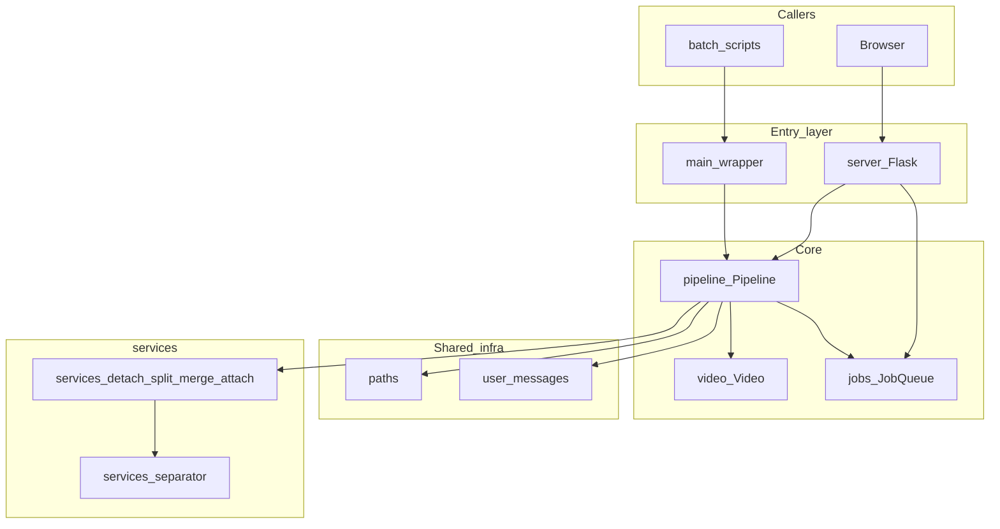
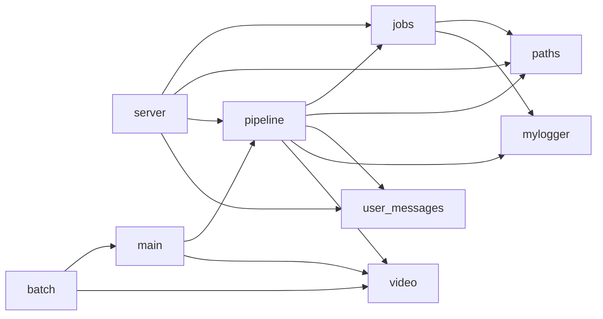
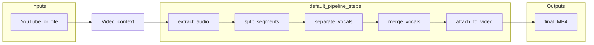

# ADR 0001: Core modules and pipeline orchestration

## Status

Accepted

## Architecture (diagrams)

### System context

Entry points converge on **`Pipeline`**, which drives **`Video`** through **`services/`** steps and optionally updates **`JobQueue`** (web jobs).

### Module dependencies (simplified)

### Processing flow (one video)

`JobQueue` receives **status updates** at each step when `Pipeline` is constructed with a `job_id` (async web jobs).

## Context

CleanVedio is a small Python app: a linear **video processing pipeline** (download → extract audio → split → separate vocals → merge → attach), exposed via **Flask** and **batch** scripts.

Historically, **`pipeline.py`** bundled job persistence, orchestration, user-facing errors duplicated with `server.py`, and data-directory logic that did not always match the packaged server layout. **Pipeline steps** were a fixed sequence inside one method, so adding or reordering steps required editing the orchestrator body.

We wanted **clearer single-purpose modules**, **one place for paths and user messages**, **test-friendly dependency seams** (without a DI framework), and **optional extensibility** for the step list—without turning the project into a large “clean architecture” codebase.

## Decision

1. **Paths** live in [`paths.py`](../../paths.py): `get_app_root()`, `get_resource_root()`, `get_data_root()`, and `ensure_data_root()`, aligned with packaged (frozen) and development layouts. Server and pipeline both consume this for a single notion of where data and outputs live.
2. **Jobs** live in [`jobs.py`](../../jobs.py): `JobStatus`, `JobInfo`, `JobQueue`, JSON persistence, and the process-wide `job_queue` singleton. This isolates concurrency and storage from orchestration.
3. **User-facing errors** live in [`user_messages.py`](../../user_messages.py) as `friendly_failure_message()`. Flask and the pipeline use the same mapping so API and logged behavior stay consistent.
4. **`Pipeline`** in [`pipeline.py`](../../pipeline.py) focuses on orchestration and I/O entry helpers (`process_youtube`, `process_file`). It accepts an **optional** `job_queue` (defaults to `jobs.job_queue`) so tests or alternate runners can substitute a double. Steps are a **list of `(JobStatus, progress_message, callable)`** tuples from `default_pipeline_steps()`; the list may be overridden per instance for future customization.
5. **Logging** in vocal separation (CLI Spleeter path) uses the shared project logger instead of `print` for consistent operability.

`pipeline.py` **re-exports** `JobStatus`, `JobInfo`, `JobQueue`, and `job_queue` for backward-compatible imports; preferred style for new code is to import job types from `jobs`.

## Consequences

### Positive

- **Single responsibility** per file for paths, job store, messages, and orchestration.
- **No duplicated** data-root or friendly-error logic between server and pipeline.
- **Open/closed (lightweight)**: new steps can be added by extending the default list or passing a custom `steps` argument without growing a monolithic `process()` body.
- **Dependency inversion (lightweight)**: `Pipeline(..., job_queue=...)` enables fakes without changing production call sites.

### Negative / trade-offs

- **`Video`** remains a wide, mutable **context object** passed through services; narrow typed interfaces per step were deliberately deferred as overkill for current size.
- **`Pipeline` still owns** YouTube/file entry points; further splits (e.g. dedicated “download coordinator”) would be follow-on ADRs if that code grows.
- **Global `job_queue`** remains the default wiring; explicit injection is opt-in.

### Follow-up (optional)

- Introduce a small `ProgressSink` **protocol** if job updates need to fan out beyond `JobQueue` (e.g. metrics).
- Document per-service **read/write fields** on `Video` if the model grows.
- Split `server.py` into **blueprints** or a thin `app factory` if HTTP surface area grows.
